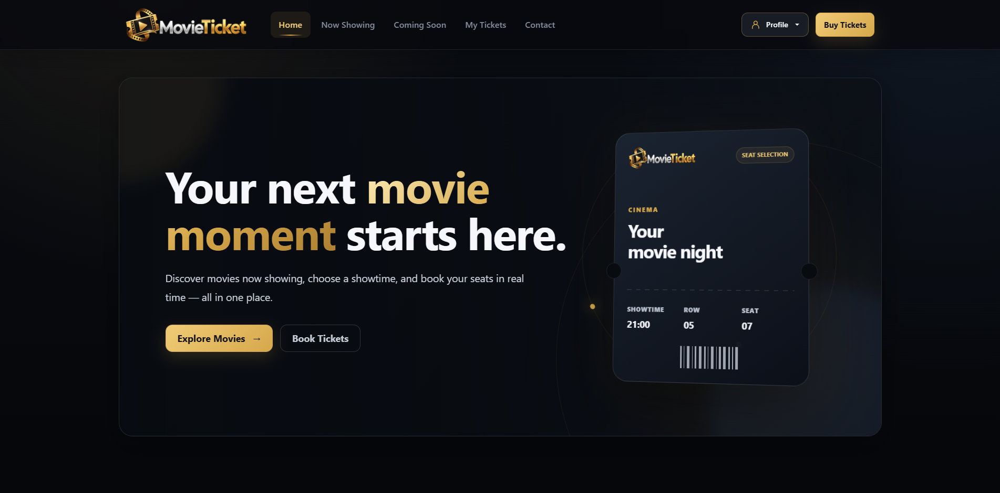
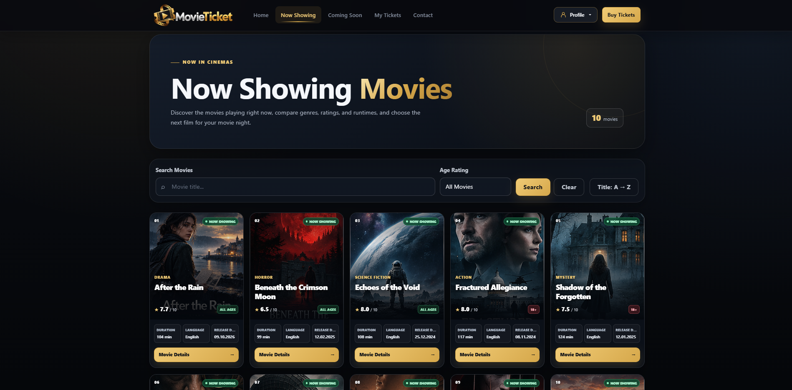
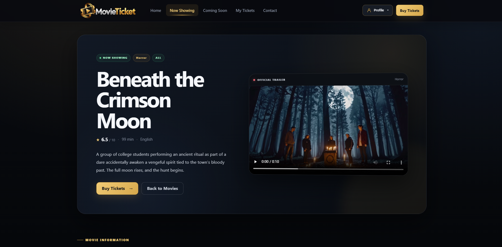
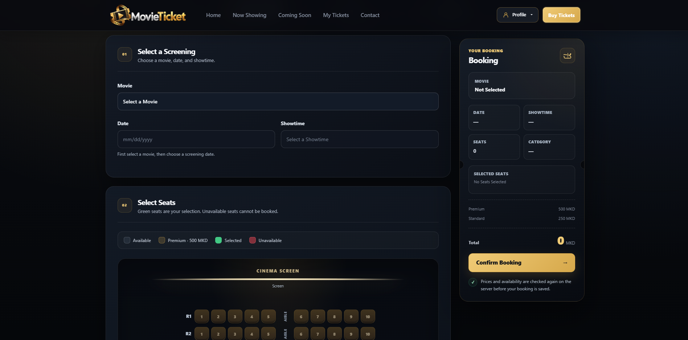
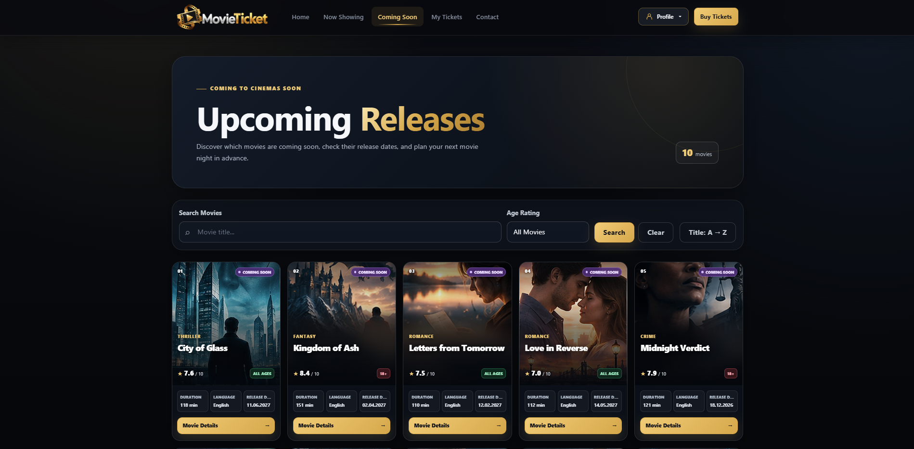
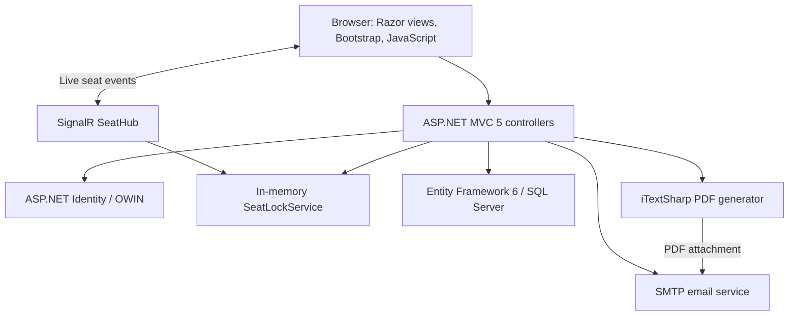

<p align="center">
  
</p>

<h1 align="center">MovieTicketMVC</h1>

<p align="center">
  A full-stack cinema booking application featuring real-time seat selection, concurrency-safe reservations, role-based movie management, and PDF ticket confirmations.
</p>

<p align="center">
  <a href="https://github.com/nikolasarafimov/movie-ticket-mvc-app/actions/workflows/ci.yml"></a>
  
  
  
  
</p>

<p align="center">
  <a href="#screenshots">Screenshots</a> ·
  <a href="#features">Features</a> ·
  <a href="#booking-flow">Booking Flow</a> ·
  <a href="#architecture">Architecture</a> ·
  <a href="#getting-started">Getting Started</a> ·
  <a href="#limitations-and-future-work">Limitations</a>
</p>

## Overview

**MovieTicketMVC** is a full-stack cinema reservation application built with **C#**, **ASP.NET MVC 5**, **Entity Framework 6**, **ASP.NET Identity**, and **SignalR** on **.NET Framework 4.7.2**.

It combines a searchable movie catalogue with an interactive **100-seat booking interface**. The application manages temporary seat holds in real time, validates bookings on the server, and coordinates concurrent reservations with SQL Server transactions and application locks. After a successful reservation, users can review their tickets and receive a PDF confirmation by email when SMTP is configured.

This project demonstrates practical MVC architecture, relational database access, authentication and authorization, real-time communication, concurrency management, secure file handling, and a responsive cinematic user interface.

> **Important:** MovieTicketMVC records **cinema reservations**, not online payments. It does **not** include a payment gateway, and a generated PDF confirms a booking rather than proof of payment.

## Screenshots

### Home Page



*The landing page introduces the MovieTicket experience through a custom dark theme, cinematic typography, and responsive visual design.*

<table>
  <tr>
    <td width="50%" valign="top">
      
      <br><strong>Movie Catalogue</strong>
      <br><sub>Explore currently showing movies and browse available titles.</sub>
    </td>
    <td width="50%" valign="top">
      
      <br><strong>Movie Details</strong>
      <br><sub>Review movie information, cast, ratings, and screening details.</sub>
    </td>
  </tr>
  <tr>
    <td width="50%" valign="top">
      
      <br><strong>Interactive Seat Selection</strong>
      <br><sub>Select a screening and seats while viewing availability and pricing.</sub>
    </td>
    <td width="50%" valign="top">
      
      <br><strong>Coming Soon</strong>
      <br><sub>Discover upcoming releases and plan a future movie night.</sub>
    </td>
  </tr>
</table>

## Features

| Area | Capabilities |
| --- | --- |
| **Movie catalogue** | Now Showing and Coming Soon pages, title search, sorting, age filtering, detailed movie information, and locally hosted trailers |
| **Accounts** | Registration, login and logout, account management, password recovery, and email-related identity flows |
| **Authorization** | User and administrator roles, protected movie-management actions, and restricted ticket history |
| **Booking** | Movie, screening date, showtime, age category, and individual seat selection |
| **Live availability** | SignalR updates when temporary seat holds are acquired or released |
| **Concurrency** | Server-side booking checks, serializable transactions, and SQL Server application locks |
| **Tickets** | Booking summaries, personal booking history, admin booking overview, and PDF generation |
| **Notifications** | Optional SMTP confirmation email with a PDF attachment |
| **UI** | Dark cinematic theme, responsive layouts, accessibility labels, and reduced-motion support |

### Movie management

Administrators can create and edit movies, manage their metadata, and upload or replace local trailers. Movies with associated ticket purchases cannot be deleted through the movie-management flow. Trailer uploads are validated on the server, with a **200 MiB** maximum file size.

## Booking Flow

1. **Explore movies** and review a title's details.
2. **Log in or register** to access ticket booking.
3. **Choose a movie, date, and showtime**, subject to screening and release-date validation.
4. **Select seats** from the interactive **10 × 10 cinema layout**. SignalR communicates temporary seat holds to other connected clients.
5. **Confirm the reservation**. The server revalidates the submitted details, seat holds, pricing, and persisted seat availability.
6. **View your booking** in the ticket summary or **My Tickets**. The application also attempts to send an email with an attached PDF confirmation.

### Seating and pricing

| Seating zone | Rows | Price per seat |
| --- | --- | ---: |
| Premium | 1–2 | **500 MKD** |
| Standard | 3–10 | **250 MKD** |

**Available screening times:** `10:00`, `14:00`, `18:00`, and `21:00`.

A seat ID such as `R3C5` identifies row 3, column 5. The final price is calculated and validated on the server rather than trusted from browser input.

### Real-time holds and booking concurrency

MovieTicketMVC uses **ASP.NET SignalR 2** and an in-memory `SeatLockService` to coordinate provisional seat holds. Ordinary holds last **15 minutes**; releases and expirations can be broadcast to connected clients.

A temporary hold is not the final source of truth. During confirmation, the server:

1. Verifies the user's seat holds and submitted booking details.
2. Opens a **serializable SQL Server transaction**.
3. Acquires a transaction-scoped exclusive application lock using **`sp_getapplock`** for the selected screening.
4. Rechecks persisted tickets for overlapping seats.
5. Saves the ticket and commits the transaction only when validation succeeds.

This approach separates responsive live seat selection from the final database-backed reservation check.

## Architecture



### Project structure

```text
movie-ticket-mvc-app/
├── .github/workflows/       GitHub Actions CI
├── docs/screenshots/        README screenshots
├── MovieTicketMVC/
│   ├── App_Start/          MVC, Identity, OWIN, routing, and bundles
│   ├── Controllers/        Accounts, profiles, movies, and tickets
│   ├── Models/             Entities and view models
│   ├── Views/              Razor pages and shared layouts
│   ├── Hubs/               SignalR seat communication
│   ├── Services/           Seat locks, PDF generation, and email
│   ├── Migrations/         EF6 migrations and database seeding
│   ├── Content/            Styles, images, and local trailers
│   ├── Scripts/            Client-side libraries
│   ├── Startup.cs          Application startup
│   └── Web.config          Application configuration
├── MovieTicketMVC.sln
└── README.md
```

### Technology stack

| Layer | Technology |
| --- | --- |
| Runtime and language | **.NET Framework 4.7.2**, **C#** |
| Server framework | ASP.NET MVC 5, Razor |
| Database access | Entity Framework 6 |
| Development database | SQL Server LocalDB |
| Authentication | ASP.NET Identity, OWIN cookies |
| Real-time communication | ASP.NET SignalR 2 |
| Front end | Bootstrap 5, jQuery, JavaScript, custom CSS |
| PDF generation | iTextSharp |
| Email notifications | SMTP |
| Continuous integration | GitHub Actions on Windows |

## Getting Started

### Prerequisites

MovieTicketMVC is a **classic ASP.NET / .NET Framework application** intended for development on Windows.

- Visual Studio 2022 with ASP.NET/web development support
- .NET Framework 4.7.2 targeting pack
- SQL Server LocalDB
- NuGet package restore support
- Git

### 1. Clone and open the solution

```bash
git clone https://github.com/nikolasarafimov/movie-ticket-mvc-app.git
cd movie-ticket-mvc-app
```

Open `MovieTicketMVC.sln` in Visual Studio and restore the NuGet packages. The project uses `packages.config`.

Alternatively, use a Visual Studio Developer Command Prompt:

```powershell
nuget restore MovieTicketMVC.sln
```

### 2. Set up the database

The development connection string in `MovieTicketMVC/Web.config` targets **SQL Server LocalDB**. Adjust the connection string if your local SQL Server setup differs.

In **Visual Studio → Tools → NuGet Package Manager → Package Manager Console**, run:

```powershell
Update-Database -ProjectName MovieTicketMVC -StartUpProjectName MovieTicketMVC -Verbose
```

Entity Framework migrations create or update the database.

### 3. Optional: seed demonstration movies

The predefined catalogue is **opt-in**. To populate it, configure the following environment variable **before** running the database update:

```text
MOVIETICKET_SEED_DEMO_MOVIES=true
```

Restart Visual Studio after setting environment variables, then run `Update-Database` again. Existing movies are matched by title; seeding does not replace the complete database.

### 4. Optional: initialize an administrator

Set both of these environment variables:

```text
MOVIETICKET_ADMIN_EMAIL
MOVIETICKET_ADMIN_PASSWORD
```

Use a valid email address and a strong password that satisfies the application's password policy. Restart Visual Studio and run the database update after configuration.

For security, the seed logic **does not automatically promote an existing non-administrator account**. Administrator access for an existing user must be assigned separately after verifying account ownership.

**Never commit passwords, credentials, or other secrets.**

### 5. Optional: configure email confirmations

| Environment variable | Purpose |
| --- | --- |
| `MOVIETICKET_SMTP_HOST` | SMTP server; defaults to `smtp.gmail.com` |
| `MOVIETICKET_SMTP_PORT` | SMTP port; defaults to `587` |
| `MOVIETICKET_SMTP_USERNAME` | SMTP username |
| `MOVIETICKET_SMTP_PASSWORD` | SMTP password or app password |
| `MOVIETICKET_SMTP_FROM` | Optional sender address; defaults to the username |

The email service uses TLS-enabled SMTP. Store credentials in environment variables, not in source code.

**Email delivery is optional.** If PDF generation or SMTP delivery fails after the booking transaction commits, the reservation remains saved and accessible under **My Tickets**, and the application displays a delivery warning.

### 6. Build and run

Build in Visual Studio or use a Visual Studio Developer Command Prompt:

```powershell
msbuild MovieTicketMVC.sln /p:Configuration=Release /m
```

Set `MovieTicketMVC` as the startup project and launch with **IIS Express over HTTPS**. The authentication cookie is configured as secure-only, so HTTPS is important for sign-in functionality.

## Security and Validation

The implementation includes:

- Role-based authorization for movie administration and ticket history.
- Anti-forgery validation for relevant state-changing MVC requests.
- Server-side validation of movies, screening dates and times, age categories, seats, and ticket prices.
- SQL Server transaction-level coordination to reduce overlapping booking conflicts.
- Ownership checks for ticket summaries.
- Trailer file-size, extension, and signature validation.
- Secure authentication-cookie settings and account lockout functionality.
- SMTP and administrator credentials supplied through environment variables.

These application-level safeguards are **not a substitute for a full security assessment** before production deployment.

## Continuous Integration

The [GitHub Actions CI workflow](.github/workflows/ci.yml) runs on pushes and pull requests targeting `main`. It restores NuGet packages and builds the solution in **Release** mode on a Windows runner.

**The current workflow validates restore and compilation.** It does not run automated end-to-end booking tests or deploy the application.

## Limitations and Future Work

- **Single-instance seat holds:** The in-memory lock service is local to one application instance; distributed hosting would require shared state or coordination.
- **No online payment processing:** Bookings and PDF files are confirmations, not payment receipts.
- **Optional notifications:** Email delivery requires correctly configured SMTP credentials.
- **Local media storage:** Trailer uploads use the application filesystem; persistent object storage would be more suitable for scalable cloud deployment.
- **Ticket-seat persistence:** Dedicated ticket-seat records with database-level uniqueness constraints would provide a stronger long-term model.
- **Automated testing:** CI currently checks compilation, not end-to-end behavior or concurrent booking scenarios.

Potential enhancements include distributed holds, payment integration, automated integration and end-to-end tests, cloud media storage, and a deployment pipeline.

## Author

**Nikola Sarafimov**  
GitHub: [@nikolasarafimov](https://github.com/nikolasarafimov)

## License and Usage

This repository is provided as an **educational and portfolio project**. It currently has **no root-level `LICENSE` file**, so no open-source license is asserted for the project's own code. Third-party libraries and assets remain subject to their respective licenses and rights.